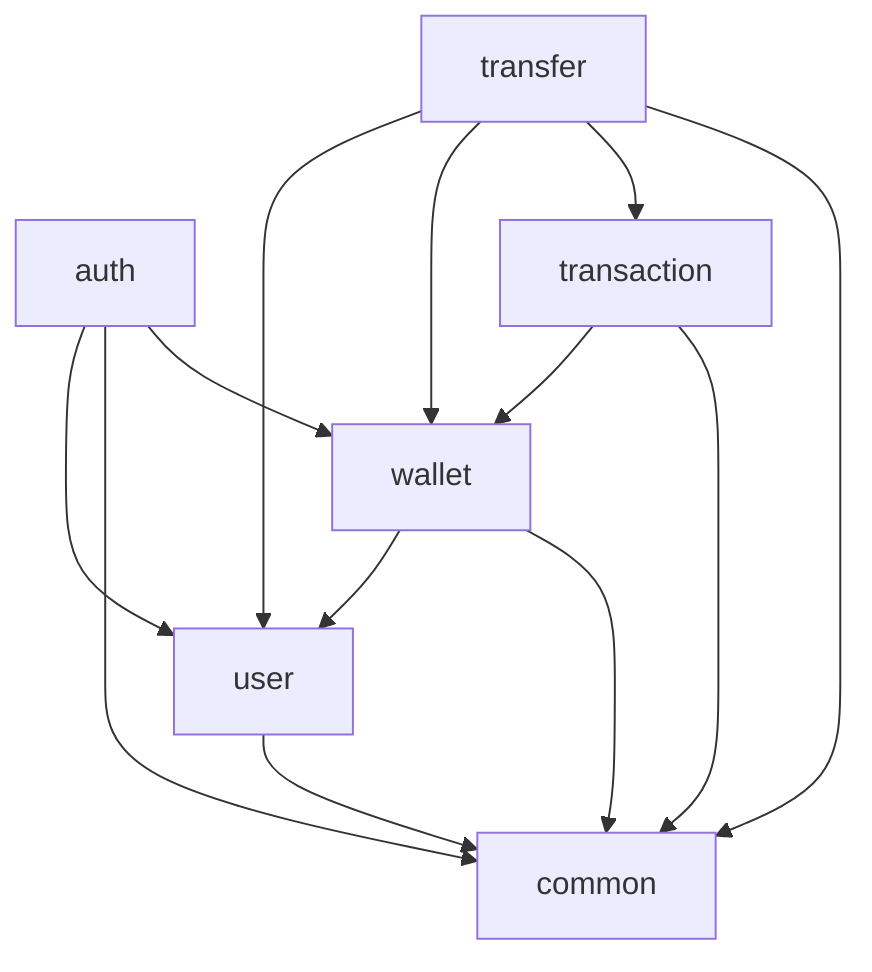
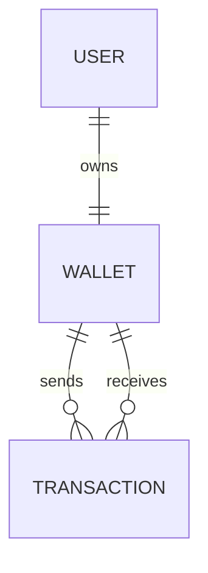

# Architecture Spine - PayNest MVP

## Design Paradigm

PayNest is a package-by-feature, layered modular monolith. It is one Spring Boot application, one deployable artifact, and one PostgreSQL database. HTTP adapters delegate to application services; application services coordinate domain behavior and owning-module persistence; all cross-module work remains in-process. The `transfer` slice is an application use case, not a domain entity or deployable service.

## Invariants & Rules

### AD-1 - One modular monolith [ADOPTED]

- **Binds:** all MVP capabilities, AC-QUALITY-4
- **Prevents:** independent builders introducing network boundaries, multiple deployables, separate databases, or microservice infrastructure.
- **Rule:** Build exactly one Spring Boot application, one deployment unit, one PostgreSQL database, and one local transaction manager. Modules call one another in process. No gateway, broker, discovery, cache, distributed transaction, or Kubernetes component belongs to the MVP.

### AD-2 - Three-entity domain and relationship ownership [ADOPTED]

- **Binds:** FR-2, FR-6, FR-8, FR-10..FR-13; BR-W1..BR-W5; BR-T3..BR-T8
- **Prevents:** extra persisted concepts, ambiguous foreign-key ownership, and unbounded entity graphs.
- **Rule:** Persist only `User`, `Wallet`, and `Transaction`. Wallet owns the required unique User one-to-one FK. Transaction owns required sender-Wallet and receiver-Wallet many-to-one FKs. Wallet has no Transaction collections. `Transfer` owns no entity, table, or repository.

### AD-3 - Feature ownership and cross-module seams

- **Binds:** all implementation units under `auth`, `user`, `wallet`, `transfer`, `transaction`, and `common`
- **Prevents:** controllers with business logic, repository orchestration, cyclic Auth/User dependencies, and incompatible cross-feature APIs.
- **Rule:** Controllers validate/map HTTP only. Each entity's feature declares and owns its repository, but focused application coordinators may use the required owning repositories directly to keep one atomic use case readable. Registration lives in `auth.application`, which may depend on User and Wallet persistence; Wallet depends on User for its mapping, and User never depends on Wallet. Transfer is the other approved cross-feature coordinator. Extract a concrete helper service only when it represents a reused or meaningful business capability or prevents a god service. Named helpers are examples, not mandatory seams; interfaces require a concrete polymorphic or boundary need.



### AD-4 - Atomic registration [ADOPTED]

- **Binds:** FR-1, FR-2; BR-U1, BR-U2, BR-U5; AC-AUTH-1..AC-AUTH-3
- **Prevents:** a committed User without a Wallet, plaintext credentials, and duplicate normalized email under races.
- **Rule:** `auth.application.RegistrationService` owns one application transaction covering email normalization, PBKDF2 password encoding, User insert, and creation of exactly one `0.00 USD` Wallet. It may use User and Wallet repositories directly or delegate Wallet creation to a meaningful concrete helper. User and Wallet both commit or neither commits. The unique email constraint is authoritative. Mutating failures are unchecked or explicitly covered by `rollbackFor`.

### AD-5 - Atomic transfer and completed-only record [ADOPTED]

- **Binds:** FR-7, FR-8, FR-10; BR-T1..BR-T6; AC-TRANSFER-1..AC-TRANSFER-6; AC-TXN-5
- **Prevents:** partial debit/credit, Transaction records for failed attempts, and Wallet-owned orchestration sprawl.
- **Rule:** `TransferService` owns one application transaction covering trusted Sender resolution, Recipient resolution, both Wallet locks, validation, debit, credit, and Transaction insertion. It is the required orchestration point and may use the owning repositories directly; helper services remain optional refactorings. All three state changes commit together. A failure rolls back all changes and persists no Transaction; the only persisted status is `COMPLETED`.

### AD-6 - Ordered PostgreSQL pessimistic locks

- **Binds:** FR-9; AC-WALLET-4; AC-TRANSFER-5
- **Prevents:** lost updates, concurrent overspending, negative balances, and avoidable opposite-direction deadlocks.
- **Rule:** The Wallet repository exposes the focused pessimistic-write query used by `TransferService` to lock both Wallets in ascending Wallet-ID order under `READ COMMITTED`; state-dependent rules are rechecked while locks are held. A helper may encapsulate this only if it improves clarity. Configure a finite externalizable session lock timeout and no hidden retry. SQLSTATE `40P01`/`55P03` lock conflicts roll back and map to `409 CONFLICT`; other Transfer data failures map to `500 TRANSACTION_FAILED`. No JVM or distributed lock is permitted.

### AD-7 - Exact schema, money, time, and migration ownership [ADOPTED]

- **Binds:** FR-2, FR-7, FR-9..FR-13; database requirements
- **Prevents:** floating-point loss, silent rounding, front-loaded domain tables, migration-version collisions, rewritten shared migrations, divergent schemas, and non-deterministic history order.
- **Rule:** IDs are generated `BIGINT`; money is Java `BigDecimal` and PostgreSQL `NUMERIC(19,2)` with scale over 2 rejected; time is Java `Instant` and PostgreSQL `TIMESTAMPTZ`. Flyway versioned SQL exclusively changes schema. The foundation creates no domain table; `V1__create_users.sql` ships with the User mapping, `V2__create_wallets.sql` with the Wallet mapping, and `V3__create_transactions.sql` with the Transaction mapping and history indexes. Shared migrations are append-only and Hibernate uses `ddl-auto=validate`. Database checks enforce non-negative balance, positive amount, USD-only Wallets, distinct sender/receiver, and completed-only status.

### AD-8 - Stateless JWT and acyclic trusted identity

- **Binds:** FR-3..FR-6, FR-11, FR-12; BR-U3, BR-U4, BR-T1, BR-T7
- **Prevents:** caller-forged ownership, Auth/User package cycles, credential leakage, and scope growth into sessions/roles.
- **Rule:** Spring Security is stateless. The two Auth operations are public; the other five product operations require a valid expiring HS256 JWT whose subject is the stable User ID. The filter resolves the User and places feature-neutral `common.security.AuthenticatedUser` in `SecurityContext`; controllers pass only its trusted ID to services. Passwords use the stored encoder ID `{pbkdf2@SpringSecurity_v5_8}` with Spring Security's 16-byte salt, 310,000-iteration PBKDF2-HMAC-SHA-256, 256-bit profile so all valid 8-72 Unicode-character inputs are processed without truncation. No refresh tokens, roles, OAuth2, or session storage exist.

### AD-9 - Seven product operations and PRD-exact errors [ADOPTED]

- **Binds:** FR-1..FR-14; API and error requirements
- **Prevents:** convenience endpoint growth and independent error vocabularies.
- **Rule:** Expose exactly the seven MVP product operations in the PRD; OpenAPI/Swagger assets are documentation resources, not added product operations. Preserve all PRD request/response/status contracts. Errors use `{timestamp,status,error,message,path}` plus optional `fieldErrors` object. Stable codes are exactly `VALIDATION_ERROR`, `AUTHENTICATION_FAILED`, `INVALID_TOKEN`, `ACCESS_DENIED`, `USER_NOT_FOUND`, `WALLET_NOT_FOUND`, `TRANSACTION_NOT_FOUND`, `EMAIL_ALREADY_EXISTS`, `CONFLICT`, `SELF_TRANSFER_NOT_ALLOWED`, `INSUFFICIENT_BALANCE`, `TRANSACTION_FAILED`, and `INTERNAL_ERROR`.

### AD-10 - Lazy persistence and explicit DTO boundary

- **Binds:** FR-5, FR-6, FR-10..FR-13; security requirements
- **Prevents:** recursive entity serialization, N+1 history queries, accidental credential exposure, and cascade deletion.
- **Rule:** Associations are lazy; responses use dedicated DTOs and explicit mapping. History/detail queries explicitly fetch or project only required participants/counterparties. No relationship has cascade delete or orphan removal. Registration explicitly persists User and Wallet. User has no inverse `wallet` field; use cases query Wallet by User ID rather than relying on inverse one-to-one lazy loading.

### AD-11 - PostgreSQL-backed verification

- **Binds:** all acceptance criteria; testing requirements
- **Prevents:** mocks or H2 falsely proving constraints, rollback, locking, ownership, or query efficiency.
- **Rule:** Unit tests cover pure rules. Integration tests use a dedicated developer-managed PostgreSQL database named exactly `paynest_test`, supplied through `PAYNEST_TEST_DB_*`; a test-only database-name guard runs before cleanup or schema reset. These tests cover HTTP, security, JPA mappings, Flyway, constraints, atomic rollback, and authorization. Separate-transaction concurrency tests prove no overspend/lost update. A query-count or equivalent SQL-shape test proves a 20-item history page does not issue one counterparty query per row. OpenAPI contract tests assert the seven PRD product paths and exact error schema. H2 and container-based substitutes do not provide acceptance evidence.

### AD-12 - Development funding and delivery boundary [ADOPTED]

- **Binds:** AC-WALLET-3, AC-QUALITY-3..AC-QUALITY-5
- **Prevents:** a public funding feature, container-based delivery, secrets in source, and hidden infrastructure.
- **Rule:** New Wallets start at zero. Funding is available only through test fixtures or a manual local-only SQL helper outside production routes/classpath. Delivery is direct local Spring Boot startup against developer-managed PostgreSQL; container tooling is outside scope. Secrets are externalized; no sensitive payload/token/hash is logged.

## Consistency Conventions

| Concern | Convention |
|---|---|
| Names | Singular Java entity names; plural SQL tables; concrete use-case services; `*Request`/`*Response` DTOs. Interfaces and `*Access` wrappers are demand-driven, not defaults. |
| IDs and time | `Long`/`BIGINT`; ISO 8601 UTC externally; `Instant`/`TIMESTAMPTZ` internally. |
| Money | `BigDecimal`/`NUMERIC(19,2)`; two decimals; never float/double; reject rather than round excess scale. |
| Persistence | Each feature declares its entity repository once; focused coordinators may access it under AD-3. No entity serialization, delete cascades, or orphan removal. |
| Mutations | Transaction boundary surrounds the full registration or transfer use case; escaping failure must cause rollback. |
| Identity | Controller extracts `AuthenticatedUser.userId`; no User/Wallet owner ID is accepted from client input. |
| Pagination | Zero-based; default 20; maximum 100; fixed `createdAt DESC, id DESC`. |
| Errors | PRD codes and envelope only; `fieldErrors` is a field-to-message object; no technical or sensitive detail. |
| Configuration | Safe defaults in YAML; credentials, JWT secret, and deploy-specific values from environment/untracked local config. |

## Stack

| Name | Version |
|---|---:|
| Java | 25 LTS |
| Spring Boot | 4.1.1 |
| Maven Wrapper | 3.10.0 |
| PostgreSQL | 18.6 |
| Flyway | 12.4.0 (Boot-managed) |
| PostgreSQL JDBC | 42.7.13 (Boot-managed) |
| JJWT | 0.13.0 |
| springdoc-openapi | 3.1.1 |
| JUnit Jupiter | 6.0.3 (Boot-managed) |
| PostgreSQL integration database | Dedicated developer-managed `paynest_test` |

## Structural Seed

```text
src/main/java/com/paynest/
  auth/          # sign-up/sign-in orchestration, JWT issuance/filter/security config
  user/          # User entity, current-User queries, User persistence
  wallet/        # Wallet entity, balance rules, persistence, and Wallet queries
  transfer/      # transfer controller and coordinator; no entity/repository
  transaction/   # Transaction entity, recording/query, Transaction persistence
  common/        # safe errors, configuration, feature-neutral principal
src/main/resources/db/migration/
src/test/java/com/paynest/{unit,integration,concurrency}/
scripts/dev/fund-wallet.sql
```



## Capability to Architecture Map

| Capability / area | Lives in | Governed by |
|---|---|---|
| FR-1..FR-2 Sign up and Wallet creation | `auth.api/application`, User and Wallet persistence | AD-2, AD-3, AD-4, AD-7, AD-9 |
| FR-3..FR-4 Sign in and JWT protection | `auth.application`, `auth.security`, `common.security` | AD-3, AD-8, AD-9 |
| FR-5 Current profile | `user.api/application` | AD-8, AD-9, AD-10 |
| FR-6 Current Wallet | `wallet.api/application` | AD-2, AD-8, AD-9 |
| FR-7..FR-10 Transfer and record | `transfer.application`, Wallet domain/repository, Transaction repository | AD-2, AD-3, AD-5, AD-6, AD-7 |
| FR-11..FR-13 History/detail/pagination | `transaction.api/application/persistence` | AD-2, AD-3, AD-7, AD-8, AD-9, AD-10 |
| FR-14 OpenAPI | `common.config`, controller/DTO annotations | AD-9, AD-11 |
| Error/security/test/delivery concerns | `common`, `auth.security`, tests, local setup documentation | AD-8, AD-9, AD-11, AD-12 |

## Deferred

- Microservice extraction, API Gateway, discovery, inter-service REST, Kafka/events, separate databases, sagas, and distributed consistency wait for an explicit post-MVP learning phase because the MVP relies on local ACID.
- Redis/caching, Kubernetes, distributed tracing, production deployment topology, and enterprise observability wait for measured operational requirements.
- All PRD-excluded product features, including public funding/deposit/withdrawal, bank/payment integration, KYC, OTP, password reset, refresh/logout, roles, notifications, multi-currency, refunds, and schedules, wait for a product-scope change.
- UUIDs, generic repositories, CQRS, event sourcing, domain-event infrastructure, and many-to-many mappings added solely for practice are deferred indefinitely because they do not serve an MVP requirement.
