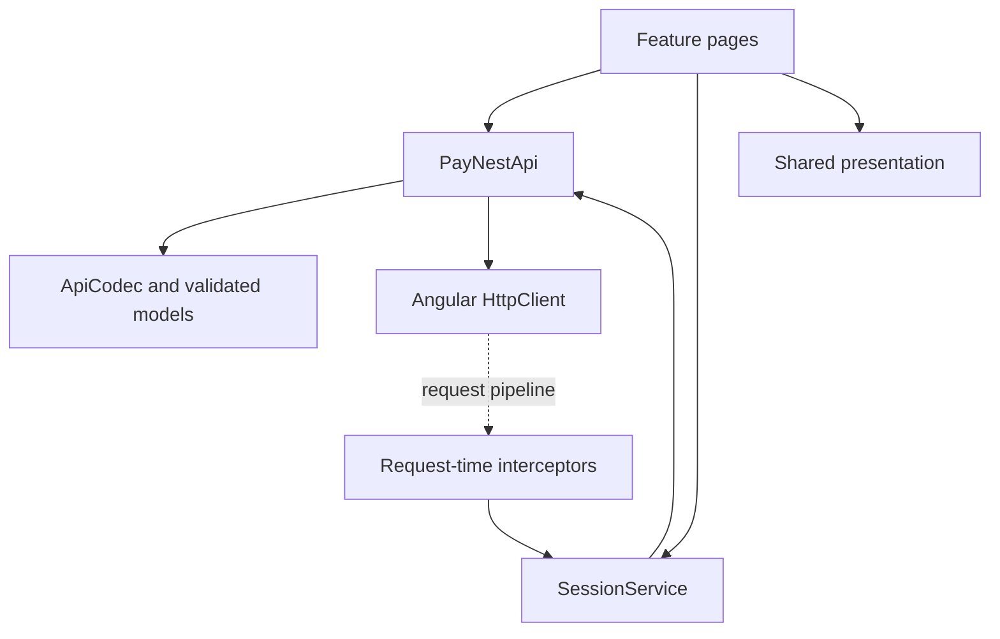
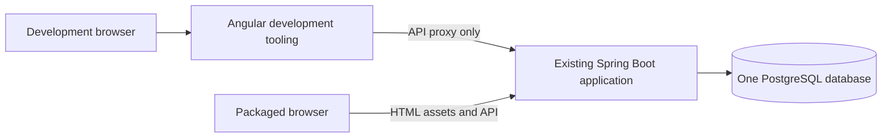

# Architecture spine — PayNest frontend

Finalized architecture for implementation planning, not authorization to build. The PRD and approved UX remain authoritative. FE-AQ-1 is resolved: Sharif accepted AD-16's script-readable JWT persistence tradeoff for this learning project. No architecture approval blockers remain; no additional product requirements are introduced.

## Design Paradigm

A client-rendered Angular SPA, organized by feature, with thin page controllers, one typed HTTP client, small session coordination, and reusable presentation only where useful. Local Signals own UI state; RxJS owns HTTP lifecycles. The backend alone owns balances, authorization and ACID operations. No SSR, global-store framework, service-interface hierarchy or frontend domain repository is required.

## Inherited Invariants

The [backend parent spine](../architecture-Java-PayNest-2026-10-06/ARCHITECTURE-SPINE.md) is read-only. New decisions continue at AD-13 so parent IDs stay unambiguous.

| Inherited | Binds here |
|---|---|
| AD-1 | One Spring Boot deployment unit and one PostgreSQL database; browser build tools are not another runtime service. |
| AD-2 | Exactly User, Wallet, Transaction; Transfer remains an operation. No frontend schema/entity. |
| AD-3 | Backend feature ownership and readable concrete services remain intact. |
| AD-4 | Registration atomically creates User plus zero USD Wallet. |
| AD-5 | Atomic transfer; immutable COMPLETED-only records; no failed-attempt records. |
| AD-6 | Ordered PostgreSQL locks remain authoritative; UI checks cannot replace them. |
| AD-7 | BIGINT, exact money, UTC timestamps, Flyway ownership and fixed history order. |
| AD-8 | Expiring bearer JWT, trusted server identity; no refresh/session/role/cookie-auth additions. |
| AD-9 | Seven product operations and existing error contracts; UI resources are not new product APIs. |
| AD-10 | DTOs only; no entity serialization or exposed Wallet relationships. |
| AD-11 | Existing guarded developer-managed `paynest_test` acceptance database, no container/H2 substitute. |
| AD-12 | Manual/test-only funding, direct local startup, externalized secrets, no Docker or sensitive logging. |

## Invariants & Rules

### AD-13 — Six-screen client boundary [ADOPTED]

- **Binds:** all frontend capabilities.
- **Prevents:** UI-driven product/API growth or separate runtime infrastructure.
- **Rule:** Implement only `/signup`, `/signin`, `/dashboard`, `/send`, `/transactions`, `/transactions/:id`. Root/unknown client navigation redirects to Dashboard or Sign in according to session state. Use only the seven existing API operations. Local sign-out clears client state, never calls a new logout endpoint. No funding, recipient directory, fees, profile editing, charts, refresh tokens, server sessions or new persisted entities.

### AD-14 — One HTTP boundary and explicit state ownership

- **Binds:** every page, shared component and API interaction.
- **Prevents:** duplicate HTTP contracts, cyclic feature dependencies and a global god service.
- **Rule:** One root-scoped `PayNestApi` exposes the seven typed operations, delegates transport decoding to `ApiCodec`, and owns no authentication or screen state. One root-scoped `SessionService` owns the current credential, trusted current-user result, request generation and minimal recovery metadata; it may coordinate signin/bootstrap through `PayNestApi`. Do not create route-local duplicates. Functional interceptors consult session state at request time, not through an API-to-session dependency. Pages own their transient form/read states. Features never import another feature's page or internal state. Shared presentation has inputs/events and no HTTP/storage. DTO/type interfaces are allowed; service interfaces, feature facade services and extra component classes require actual reuse, not every conceptual UX pattern.

  Service construction is side-effect-free: no constructor issues HTTP or starts bootstrap. An explicit application initializer invokes `SessionService.restore()` only after dependency construction completes. The core contract is established before feature-page stories; all consumers import it rather than inventing signatures. API methods return cold `Observable<ResponseDTO>` values with no result envelope; each subscription issues a request. Session coordination methods below return Promises and own their single HTTP subscription.



Solid arrows show direct dependencies; the dashed arrow is the request-time pipeline, not constructor-time dependency resolution.

### AD-15 — Lossless wire-to-view numeric contract

- **Binds:** all API DTOs, forms, routes, display and fixtures; FE-NFR-2.
- **Prevents:** cents/ID loss before formatting, changed wire types and incompatible client models.
- **Rule:** Every API response, including errors, enters `HttpClient` as text. `ApiCodec` uses `lossless-json` default `LosslessNumber` parsing, validates field types/ranges and maps to exported readonly models. Internal money is a canonical ungrouped decimal string with two digits after the point; IDs are canonical positive decimal strings bounded by `9223372036854775807`. `totalElements` is a nonnegative int64 string, not an EntityId. Money is bounded by `99999999999999999.99`; Wallet balance permits zero, transfer amount does not. Only bounded status/page/size/totalPages integers convert to Number after validation.

  Validate entered amount text before canonicalization: plain decimal notation, at most two entered fractional digits, no grouping/exponent/sign, no zero/negative/over-maximum value; `25.500` fails rather than rounds. Normalize valid numeric response lexemes, including exact exponent notation, without floating-point conversion; any nonzero precision beyond cents is a contract error. Bound exponent/significand processing before expansion so an out-of-range token cannot trigger unbounded allocation. Use string operations or exact integer minor units, never authoritative balance calculations. Format money by its validated text, not Angular numeric/currency pipes or Number-based locale formatting.

  Requests use library `stringify` with `new LosslessNumber(validatedAmount)` only for numeric contract fields, then send the serialized string with `Content-Type: application/json`. Actual string fields stay escaped JSON strings. Never pass wrappers to ordinary JSON.stringify, HttpClient object-body serialization, `.valueOf()`, `Number`, `parseFloat` or a number-input coercion. Route IDs stay text end to end. A valid JSON body with the wrong DTO shape is a contract error, not a typed success.

### AD-16 — Reload-persistent bearer credential [ADOPTED]

- **Binds:** signin, bootstrap, guards, sign-out and protected requests; FE-FR-3.
- **Prevents:** accidental localStorage persistence, hidden refresh/session infrastructure and overstated security.
- **Rule:** Approved learning-only mechanism: `sessionStorage`, containing only accessToken, expiresAt and a nonsecret per-login nonce. No passwords, profile, Wallet, receipt or draft data is persisted. Generate a new nonce per explicit signin, never a new JWT on reload. Bootstrap checks the stored shape/expiry, enters a restoring state, and verifies `/api/users/me` before private rendering. Invalid/expired credentials clear the session; non-authentication read failure offers explicit restore retry without rendering stale private data. Storage failure is visible and fails persistence-dependent signin/transfer safely; no silent memory-only fallback.

  Storage is origin/tab scoped, not a cross-tab session system. Do not synchronize tabs. App-created new-tab links use `noopener`; browser duplication/opener copies and browser restoration may retain a copy, whose expiry is still enforced. Do not promise that closing/restarting always destroys the credential. Sign-out acts on this tab only and does not revoke server JWTs. Switching between dev and packaged origins requires signin on that origin.

  **FE-AQ-1 — resolved:** sessionStorage remains readable to injected same-origin scripts. Sharif explicitly accepted this residual risk for the non-banking learning project. Approval is not a claim of production-safe token storage. Memory-only conflicts with approved reload behavior; HttpOnly-cookie/BFF changes are outside the current bearer-only scope.

### AD-17 — Session-generation and authorization safety

- **Binds:** all asynchronous requests, private screens and errors.
- **Prevents:** late responses restoring a signed-out User or an old 401 ending a newer login.
- **Rule:** Every signin attempt, sign-out, expiry and current-session protected 401 advances the session generation. Capture generation/credential at dispatch; stale success and error responses cannot mutate state, clear a newer credential or navigate a newer session. Clear all private views when identity changes, and cancel or disregard prior requests. Recheck expiry before protected dispatch and on focus/visibility/timer; the server remains authoritative. Current protected 401 clears saved credential/recovery metadata and private state, then routes to signin. Public signin 401 is only a generic invalid-credential result. A stale 401 cannot log out the current User.

  Attach bearer credentials only to the exact five protected PayNest method/path operations on the intended same origin. Never attach to auth, documentation, assets, arbitrary relative paths or another origin. Guards guide navigation; every resource still relies on server ownership checks. Never put tokens in URLs/logs or render API text as HTML. Angular escaping stays enabled; no trust-bypass APIs or third-party script/font/CDN dependency is needed.

### AD-18 — One explicit transfer, conservative recovery

- **Binds:** `/send`, HTTP lifecycle, reload and authentication transitions; FE-FR-5.
- **Prevents:** duplicate/replayed POSTs and false success/failure after response loss.
- **Rule:** Entry → valid inline review → one explicit confirmation → submitting. Use a per-login in-flight guard across route changes and exactly one HTTP subscription. Before dispatch, persist a separate recovery marker containing only the login nonce, local attempt key and `mayHaveSubmitted=true`; failure to store it prevents dispatch. No amount/email/token copy/receipt/replayable request belongs in the marker. A same-session marker on bootstrap or return to Send money yields unknown-outcome recovery, never a restored command or a fresh-looking safe form.

  Only a fully validated `201` plus `COMPLETED` confirms success. Classify results using the table below, not HTTP status alone or a page-local interpretation of error text. No automatic retry, interceptor retry, queue, navigation/reload/signin replay or optimistic receipt/balance. Confirmed success and known rejection clear the marker; uncertainty retains it. A deliberate fresh action after the warning is a new transfer, not retry of saved input. Wallet/history review is not proof identifying the lost request.

| Observed transfer result | Client outcome |
|---|---|
| 201 with fully valid TransferResponse and COMPLETED | Completed; retain confirmed receipt, then refresh reads. |
| Valid ApiError: 400 VALIDATION_ERROR; 404 USER_NOT_FOUND/WALLET_NOT_FOUND; 409 CONFLICT; 422 SELF_TRANSFER_NOT_ALLOWED/INSUFFICIENT_BALANCE | Rejected; clear current marker and permit deliberate correction. |
| Valid ApiError: 401 AUTHENTICATION_FAILED/INVALID_TOKEN; 403 ACCESS_DENIED | Rejected; 401 also ends the current session under AD-17. |
| Any 5xx, other/unmapped status/code pair, malformed/unexpected body, timeout, network failure or cancellation after dispatch | Unknown; retain recovery warning. No purportedly classified 5xx is treated as proof of rollback. |

  Transfer tickets have a distinct per-attempt key, never sent to the server or used as an idempotency key. Include it alongside the login nonce/boolean in the minimal marker. Settlement is idempotent and only the active ticket may clear its marker; an older same-login result cannot clear a newer attempt's warning.

  Expiry/401 clears private recovery metadata and credentials, but signin explains that a prior submission may have completed and is never resent; a generic explanation contains no prior-user facts. Explicit sign-out clears both storage entries. Changing identity never attributes an old marker to the new User. A late result from an invalidated generation cannot clear a newer marker. After confirmed success, show returned receipt/balanceAfter as at-transfer facts; read refresh failure does not change that success.

### AD-19 — Safe read states, contracts and errors

- **Binds:** Dashboard, history/detail, forms; FE-FR-1..8.
- **Prevents:** fake zero/empty states, stale route data and incompatible pagination/error models.
- **Rule:** Keep explicit loading/data/empty/error/stale states. Dashboard profile and Wallet failures are independent. A failed refresh labels old data stale. Detail ID changes immediately clear the old receipt. History uses `content,page,size,totalElements,totalPages,last`, default page0/size20, fixed size20, no invented `first` field or custom sorting. Previous/Next are bounded by metadata and commit the requested page only after success; refresh and next entry after transfer return to page0. Server order alone applies.

  Each read surface also owns a request generation and route/page key, separate from the login generation. Only the newest matching request may commit data, errors or loading completion. Cancel superseded reads or discard their results; an older detail/page/refresh response cannot overwrite the newer selection or reset its loading state.

  `ApiCodec` maps `{timestamp,status,error,message,path,fieldErrors?}`; UI uses recognized safe code/field mappings and generic fallback for malformed/unknown errors. Unknown and inaccessible detail share the same 404 presentation. Network/contract errors are client failures, not fabricated backend Transaction states. Read retry is explicit. Signup validates backend-compatible Unicode name/email/password rules; passwords are never trimmed or retained after completion/navigation. Signin does not inherit signup password-length restrictions.

### AD-20 — Approved UX and testable accessibility [ADOPTED]

- **Binds:** all six pages and shared presentation; FE-NFR-1/4.
- **Prevents:** visual drift, hidden mobile facts and inaccessible custom widgets.
- **Rule:** Map approved DESIGN tokens to global CSS variables/Tailwind theme; do not redesign their light-only visual system or add a component framework. Follow EXPERIENCE navigation, inline stages, error messages, focus/live-region rules and local-timezone receipt presentation. Use native forms/buttons/links and semantic lists/description lists; support 320px reflow, 200% zoom, full money/ID wrapping and 44px controls. Focus routes/stages/errors deliberately; status never depends on color. Twelve conceptual UX component patterns do not mandate twelve Angular classes.

### AD-21 — One deployment unit, two development processes

- **Binds:** scaffold, builds, configuration and minimal backend web integration.
- **Prevents:** a second production server, broad CORS/API authorization changes and SPA fallback swallowing APIs.
- **Rule:** During development, Angular on localhost4200 proxies `/api/**` to the existing Spring Boot localhost8080 process. Browser requests use relative `/api` paths; no CORS change is required. Ship the browser build as static resources inside the existing Spring Boot executable JAR, not as a separate Node runtime. Use base href `/`, resource URLs under `/ui-assets/`, index at classpath `/static/index.html`, and remaining browser output under `/static/ui-assets/`. Set favicon/public-asset URLs consistently. Keep generated assets in build output, not committed Java source resources.

  Build with installed Node/npm and npm ci, then copy assets during an explicit opt-in combined packaging step; ordinary backend development/tests must not require Node. No automatic toolchain installer, frontend Maven framework, Docker or infrastructure dependency is required. One combined JAR is the final-delivery acceptance artifact.

  Keep existing `/api/**` method/path authorization and JSON error behavior authoritative, including unknown API paths and methods. Only public GET HTML navigation and generated static resources may be added. A UI fallback may serve index for known and unknown UI navigation, but must exclude entire reserved `/api`, `/v3`, `/swagger-ui`, `/actuator`, `/error` and `/ui-assets` namespaces; assets never fall back to HTML. API/reserved paths must be rejected or served by their existing handler before UI routing, regardless of Accept header. No blanket public `/**` matcher. Test this boundary against the packaged JAR before acceptance.

### AD-22 — Layered verification without infrastructure growth

- **Binds:** FE-NFR-4/5 and every frontend story.
- **Prevents:** mocks falsely proving integration or already-rounded fixtures falsely proving precision.
- **Rule:** Use CLI Vitest/TestBed for pure numeric helpers, DTO validation, forms, HttpClient/interceptors and session/state transitions. Precision fixtures begin as literal raw JSON text, including maximum money, numeric exponent forms, unsafe-integer IDs and int64 totalElements. Test storage denial, reload/expiry/sign-out/401, late old-session responses, out-of-order same-session detail/history/refresh responses, duplicate subscription, marker-before-dispatch, cancelled/malformed/unknown transfer and success-with-failed-refresh paths.

  Playwright Chromium verifies six-screen keyboard/narrow-screen journeys, accessible labels/focus, pagination/ownership errors, and HTTP-level edge cases. A separate real-backend smoke uses the existing guarded developer-managed `paynest_test` database and manual/test-only funding; browser tests never reset normal development data. Verify dev proxy and packaged same-origin assets/deep links, missing assets, unknown UI routes, API deny behavior and unchanged seven-operation OpenAPI contract. No service worker/offline replay, H2 or containers. Keep automatic transfer/test retries disabled; explicit fixture reset makes deliberate smoke reruns repeatable.

## Consistency Conventions

### Shared client contract seed

Names/shapes below are the initial core exports. Response DTO field names mirror current backend records; money/ID/int64-count fields use AD-15's validated string representations internally. Only the codec owns wire adaptation. No generated client or extra runtime schema framework is required.

| PayNestApi call | Success emission |
|---|---|
| signup(SignUpRequest) | SignUpResponse |
| signin(SignInRequest) | TokenResponse |
| currentUser() | UserResponse |
| wallet() | WalletResponse |
| transfer(TransferRequest) | TransferResponse |
| history(page: number = 0) | TransactionHistoryPageResponse; size20 is set internally |
| detail(id: EntityId) | TransactionDetailResponse |

The shared `ApiFailure` error channel has `kind: http/network/contract/client`, optional validated `status` and `code`, safe `message`, and optional `fieldErrors` map. It is thrown through the Observable error channel, not returned as a success DTO; session Promise rejections use the same shape. Local client codes are not added backend ApiError codes. HTTP failures are decoded from text by the same codec; no feature parses raw error bodies.

SessionService exposes readonly Signals `phase` (anonymous/restoring/authenticated), `currentUser` (UserResponse or null), `generation` (number), `recoveryRequired` (boolean), and `transferInFlight` (boolean). Its shared operations are:

| Operation | Result / mutation |
|---|---|
| restore() | Promise of UserResponse or null; null means no valid stored credential; non-auth restore failure rejects and remains safely restoring. |
| signin(SignInRequest) | Promise of UserResponse after token persistence and trusted current-user verification; a superseded attempt cannot install credentials. |
| endSession(signout/expired/unauthorized) | Clears credentials/private recovery, advances generation and clears User; no backend mutation. |
| authorizationContext() | Snapshot for the interceptor: generation, login nonce, token, expiry; null when unusable. Never exposed as UI content. |
| beginTransfer() | Unique TransferTicket after authenticated/in-flight checks and successful marker write. |
| settleTransfer(ticket, completed/rejected/unknown) | Single-settlement, active-ticket/generation check; release in-flight guard and apply AD-18 marker policy. |
| acknowledgeUnknown() | Clears recovery only after explicit fresh-transfer intent and only when no transfer is in flight. |

TransferTicket is local coordination metadata, not a domain entity, persisted transfer payload or server request identifier. Pages retain only the generation needed for eligibility checks; the credential snapshot is confined to the interceptor/session boundary.

| Concern | Convention |
|---|---|
| Public API names | `signup`, `signin`, `currentUser`, `wallet`, `transfer`, `history`, `detail` in PayNestApi; seven methods, not seven facade classes. |
| Client model ownership | Core API exports validated readonly models; features do not duplicate response interfaces. Wallet has no ID; detail participants differ from history/transfer counterparty. Transfer response is `transaction` plus `balanceAfter`. |
| Money / identifiers | Validated decimal strings internally; JSON numeric tokens on wire; never floating-point formatting/coercion. |
| Session storage | Credential record and separate login/attempt-scoped recovery marker only; SessionService is the sole writer/clearer. No persisted private payload/cache. |
| Form state | Page-owned and ephemeral; clear passwords after completion/navigation; never restore a submitted transfer. |
| Errors / time | Safe existing codes; UTC wire instants, browser-local display with detail timezone; no SQL, tokens or raw payload logs. |
| Reproducibility | Exact direct dependency pins, one committed package-lock.json, npm ci; no standalone Vite dependency or global CLI prerequisite. |

## Stack

Verified baseline on 2026-10-19; [primary-source evidence](research-notes.md). The implementation lockfile owns subsequent exact transitive versions.

| Name | Version |
|---|---|
| Node.js / npm | 24.20.0 / 11.19.0 |
| Angular app packages / CLI / build / compiler-cli | 22.2.3 |
| TypeScript | 6.0.3 |
| RxJS / tslib | 7.8.2 / 2.8.1 |
| Tailwind CSS / Tailwind PostCSS plugin | 4.3.3 |
| PostCSS | 8.5.31 |
| lossless-json | 4.3.2 |
| Vitest / jsdom | 5.0.5 / 30.1.3 |
| Playwright Test | 1.64.1 |
| Backend | Existing parent-spine versions, unchanged |

Use the official Angular CLI starter with standalone, strict, zoneless, routing, CSS/Tailwind, Vitest, npm and SSR disabled; no nested Git initialization. Target the overlap of Angular22's supported browser baseline and Tailwind4's requirements; initial automated browser acceptance is the pinned Playwright Chromium. No legacy-browser polyfill project or native/PWA delivery is added.

## Structural Seed

```text
frontend/
  src/app/
    core/api/           # seven-method client, codec, shared DTO models
    core/session/       # credential/generation/recovery coordination, guards/interceptors
    features/auth/      # signup and signin pages
    features/dashboard/ # profile and Wallet reads
    features/transfer/  # entry, review and result on /send
    features/transactions/ # history and detail
    shared/ui/          # only genuinely reused presentation
    app.routes.ts
  src/styles.css        # approved design tokens and Tailwind
  e2e/                  # mocked edge journeys and separate real-backend smoke
```



## Capability to Architecture Map

| Capability / area | Lives in | Governing decisions |
|---|---|---|
| FE-FR-1 / FE-UJ-1 Signup | auth page, PayNestApi | AD-13..15, AD-19..22; parent AD-4 |
| FE-FR-2..3 Signin and reload | auth page, SessionService, request interceptors | AD-14..18; parent AD-8 |
| FE-FR-4 Dashboard | dashboard page | AD-15, AD-17, AD-19..22 |
| FE-FR-5 / FE-UJ-2/4 Transfer | transfer page, SessionService recovery guard | AD-15, AD-17..18, AD-20..22; parent AD-5..6 |
| FE-FR-6..7 / FE-UJ-3 Receipts | transaction pages | AD-15, AD-17, AD-19..22 |
| FE-FR-8 / FE-NFR-1..5 Shared quality | core, shared UI, tests, combined build | AD-14..22 |

## Deferred

- Exact file/class names beyond shared ownership, tiny presentation extraction and CSS utility choices belong to implementation. They cannot change model types, routes, state ownership or the approved UX.
- Hosting/provider/TLS provisioning and public deployment are outside this direct-local learning delivery. A public rollout must revisit token custody, XSS/CSP and transport; this draft is not a banking security approval. Existing safe response/logging requirements still apply locally.
- Cross-browser expansion beyond the documented framework intersection is a later test task when a concrete target device is added; no compatibility promise beyond that intersection.
- Refresh tokens, cookie/BFF authentication, server logout/revocation, global state libraries, microservices, Kafka, Redis, gateways, event/outbox/Saga patterns and Docker require a separate scope change, not future-extraction scaffolding.
